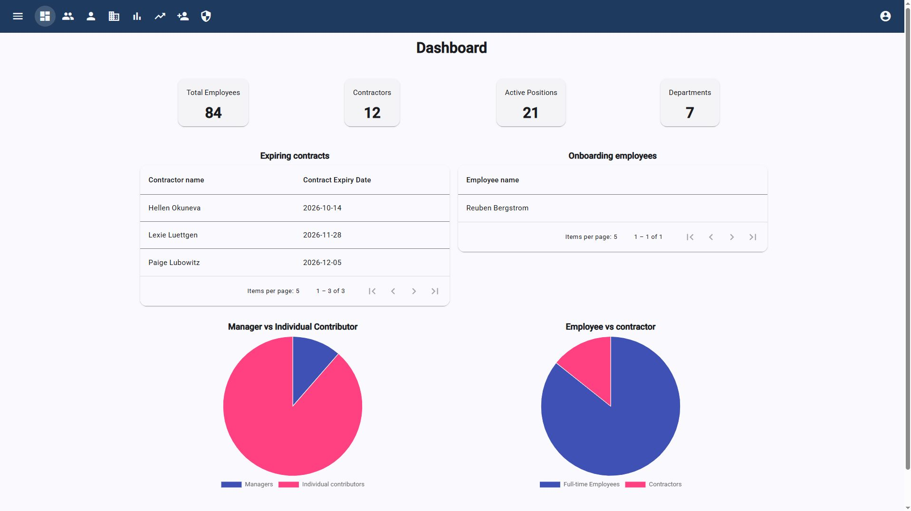
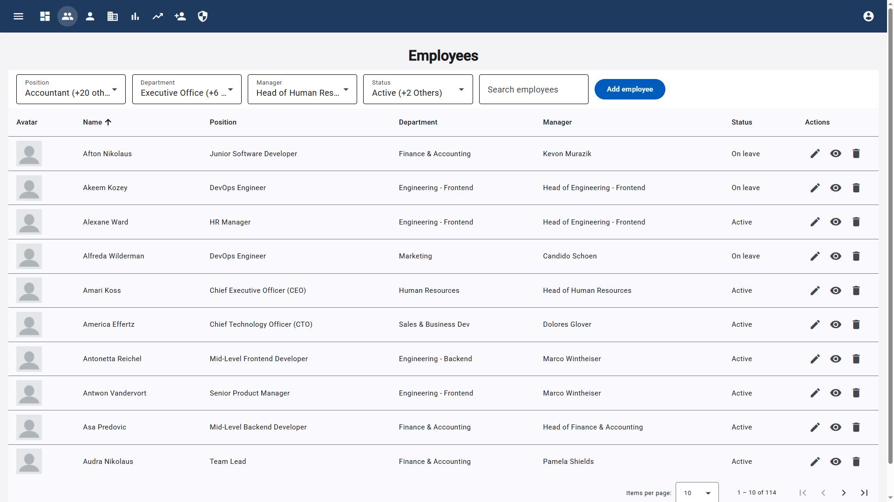
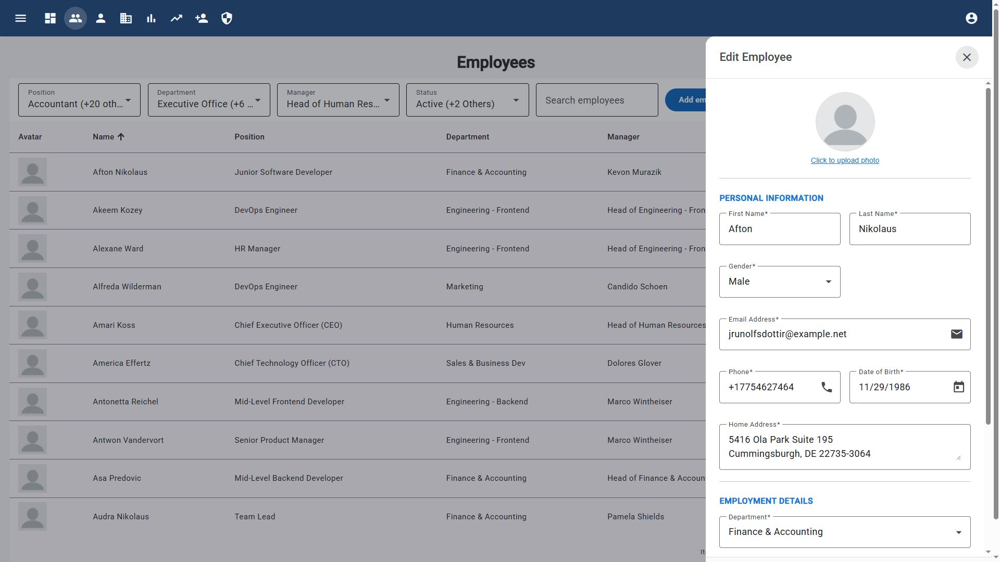
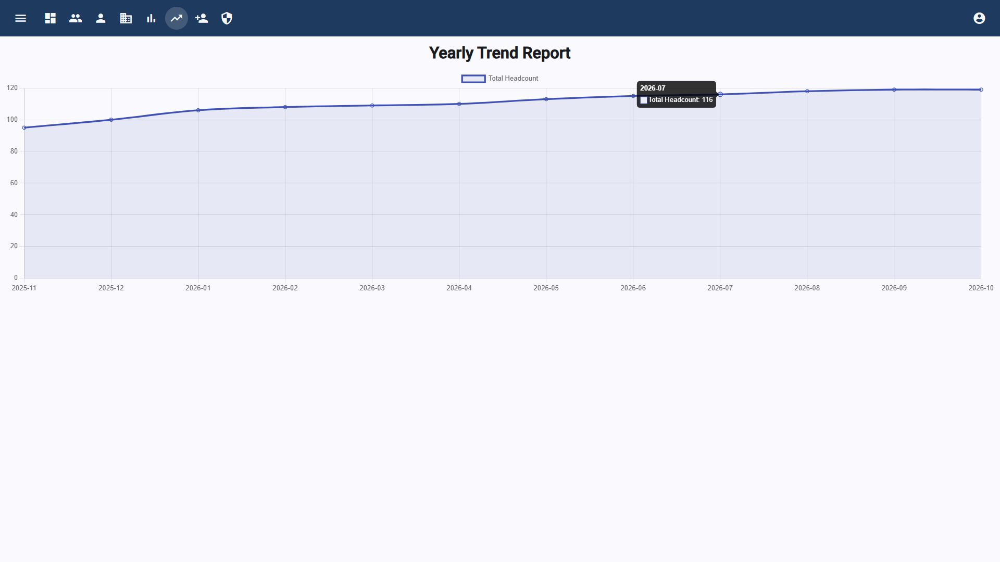
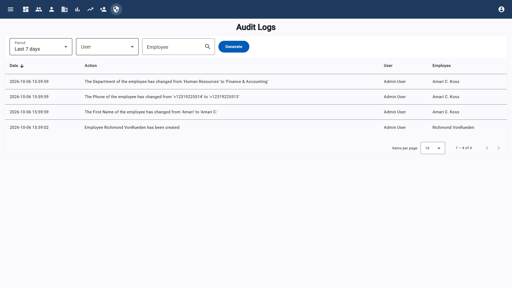

# Enterprise Employee Management System (EMS) — Frontend SPA

![Version] 1.0.0
![Angular] 21.2.15
![TypeScript] 5.9.3

A reactive, modular Single Page Application (SPA) dashboard built with **Angular 21** and **Angular Material**. This project delivers a polished, responsive user interface designed around clean architectural patterns, state management, and strict TypeScript typing.

🌐 **Backend API Repository:** https://github.com/balazs78/hrsystem-backend

---

## 🚀 Technical Highlights & Angular Concepts

*   **Declarative Role-Based UI Control:** Developed a custom structural directive (`*appHasRole`) that conditionally shows or hides menu items, buttons, and views based on the authenticated user's role.
*   **Modular Architecture:** Strict separation of concerns where HTTP communication is encapsulated entirely in dedicated, singleton **Services**, data types are mapped via explicit **Models**, and routing security is enforced by **Auth Guards**.
*   **Token-Based Authentication:** Login returns a bearer token, which is stored in local or session storage according to the “remember me” choice. An HTTP interceptor adds it as an `Authorization: Bearer` header to API requests.
*   **Reactive & Validated Forms:** Complex employee data entry utilizes Angular **Reactive Forms** built with robust validation and custom UI **Pipes** (e.g., `replace-underscore`) for professional formatting.
*   **Reusable Component Library:** Features self-contained, context-aware components such as a custom, filtered *Employee Autocomplete* component used across multiple forms.

---

## 📊 Dashboard Modules & Features

*   **Analytical Dashboard:** Dynamic widgets showing employee counts and active contracts, accompanied by interactive charts (Pie, Column, and Line diagrams) visualizing department distribution and 12-month hiring trends.
*   **Advanced Employee Datatable:** Full client-to-server integration mapping with the backend server-side pagination. Supports global text search and multi-column filtering (by department, position, manager, and status).
*   **User Provisioning and Audit Logs:** These UI areas are presented according to the authenticated user's role. Their routes are protected by authentication guards; the router does not apply the admin-only guard to the Users or Audit Logs routes.

## Authorization boundaries

Role-aware visibility in the frontend is a user-interface convenience, not an authorization boundary. The Users and Audit Logs pages have role-filtered navigation and controls, but their routes are only protected by authentication guards, not by the admin-only router guard. Users may still attempt to navigate directly to those URLs. The backend is responsible for enforcing authorization on every protected API request and remains the source of truth; hiding a frontend control or route must never be relied on to secure data or operations.

## Screenshots

### Dashboard



### Employee management

| Employee list | Employee form |
| --- | --- |
|  |  |

### Reports and audit

| Yearly trend report | Audit logs |
| --- | --- |
|  |  |

---

## 🛠️ Local Installation & Setup

1. Clone this repository and navigate into the project directory:
   ```bash
   git clone https://github.com/balazs78/hrsystem-frontend-angular
   cd hrsystem-frontend-angular
   ```
2. Install the Node project dependencies:
   ```bash
   npm install
   ```
3. Verify that the environment configuration file points to your local running backend API (`http://localhost:8000/api`).
4. Boot up the local Angular development web server:
   ```bash
   ng serve
   ```
5. Open your web browser and navigate to `http://localhost:4200`. You can now log in using any of the role profiles generated by the backend database seeders.

## API and authentication configuration

API requests use the `apiUrl` configured for the selected environment and append API
endpoints such as `/login` and `/user`. Development uses
`http://localhost:8000/api`; production currently uses
`https://hrsystem-backend-pjxe.onrender.com/api`. Update the appropriate environment
configuration if your backend is hosted elsewhere.

Authentication is token-based: the frontend saves the token returned at login and sends
it as a bearer token on API requests. This does not use cookie-based authentication or
Sanctum's CSRF-cookie flow.
